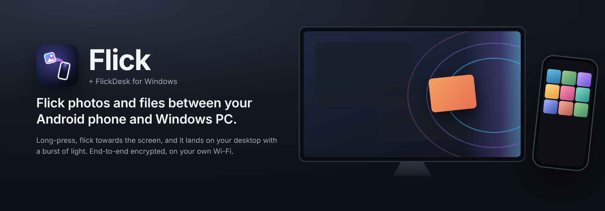
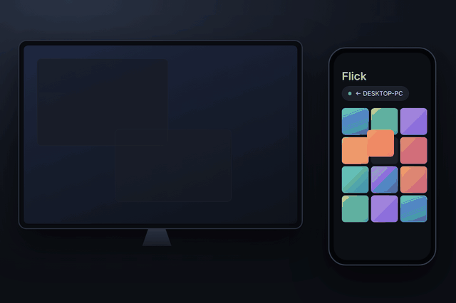
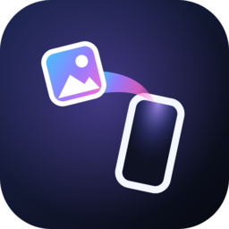
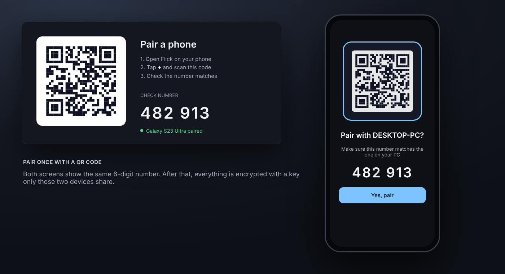
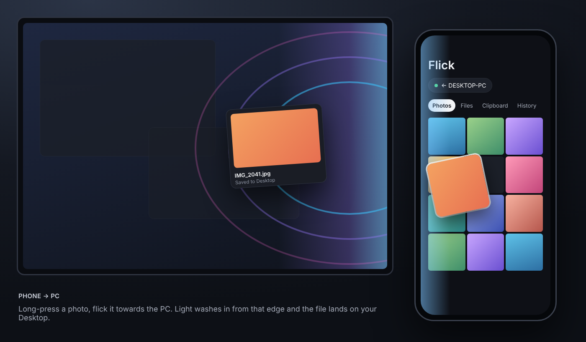
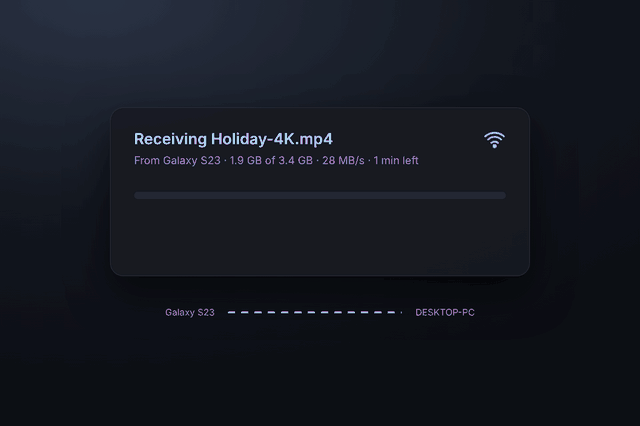
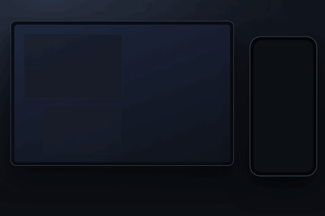

<p align="center">
  
</p>

<p align="center">
  <a href="https://github.com/samround73-cpu/FlickDesk/releases/latest"></a>
  <a href="https://github.com/samround73-cpu/FlickDesk/actions/workflows/build.yml"></a>
  
  
</p>

# Flick + FlickDesk

**Hold your phone next to your screen, long-press a photo and _flick_ it towards the PC.**
A ripple of light washes in from that edge of the monitor and the file lands on your desktop.
Going the other way, drag a file to the edge of the screen your phone sits on and let go.

- **Flick** is the Android app (Kotlin, Jetpack Compose).
- **FlickDesk** is the Windows app. It runs from the system tray (C#, WPF, .NET 8).

Both stay on your own Wi-Fi. There's no account, no cloud, and every transfer is end-to-end encrypted.

**Website:** [samround73-cpu.github.io/FlickDesk](https://samround73-cpu.github.io/FlickDesk/)

<p align="center"></p>

---

## Download

| | App | File | Needs |
|---|---|---|---|
|  | **FlickDesk** for Windows | [**FlickDesk-windows-x64.exe**](https://github.com/samround73-cpu/FlickDesk/releases/latest/download/FlickDesk-windows-x64.exe) | Windows 10 (1903+) or 11, 64-bit |
|  | **Flick** for Android | [**Flick-android.apk**](https://github.com/samround73-cpu/FlickDesk/releases/latest/download/Flick-android.apk) | Android 10 or newer |

These links always point at the [latest release](https://github.com/samround73-cpu/FlickDesk/releases/latest).
Older versions are on the [releases page](https://github.com/samround73-cpu/FlickDesk/releases).

---

## Set up in 3 minutes

### 1. Windows: run FlickDesk
1. Download **FlickDesk-windows-x64.exe** and put it somewhere permanent (for example `Documents\FlickDesk`).
   It's a single file, so there's nothing to install.
2. Double-click it.
   - **"Windows protected your PC"** (SmartScreen): the app isn't code-signed yet. Click **More info → Run anyway**.
   - **Windows Firewall** asks about network access: tick **Private networks** and click **Allow**.
     Without this the phone can't reach the PC.
3. The **Pair a phone** window opens with a QR code. FlickDesk then lives in the **system tray**
   (click the **^** arrow by the clock if you can't see it).

### 2. Android: install Flick
1. On your phone, open the [**Flick-android.apk**](https://github.com/samround73-cpu/FlickDesk/releases/latest/download/Flick-android.apk) link and download it.
2. Open the file. If asked, allow your browser or Files app to **install unknown apps**.
   If Play Protect warns you, choose **Install anyway**. The app isn't on the Play Store yet.
3. Open **Flick** and allow the photos, notifications and camera permissions when it asks.

### 3. Pair them
Your phone and PC must be on the **same Wi-Fi** network.

1. In Flick, tap **+** and scan the QR code on the PC.
2. Check the 6-digit number matches on both screens, then tap **Yes, pair**.
3. **Tell each side where the other is**, so the light comes from the right place:
   - **On the phone:** tap the PC chip and choose **Left**, **Above** or **Right**.
   - **On the PC:** go to **Settings → My phone sits on the…** and choose **Left**, **Right** or **Bottom**.

   For example, if your phone sits to the right of the laptop, set the phone to **Left** and the PC to **Right**.

<p align="center"></p>

---

## Using it

### Phone → PC
Long-press a photo until it lifts, then flick it towards the PC (or drag it to that edge of the phone).
The angle of your flick sets where along the PC's edge the light appears.
Files land on your **Desktop**, and a notification lets you open them.

To send several at once, tap photos to select them, then long-press any of them and flick once. They all go.
**Folders:** in the **Files** tab, tap **Send a folder**, pick one, then flick it. It arrives on the PC as a normal folder.

<p align="center"></p>

### PC → phone
Drag files or folders to the edge of the screen your phone sits on. A send card slides in for your phone.
Let go and they're sent. If you've paired more than one phone, they're listed under the card;
hover one to send to it instead.

You can also send from the tray icon (**Send files to phone…**).
On the phone, photos land in **Pictures/Flick**, videos in **Movies/Flick** and everything else in **Download/Flick**.
Folders are unpacked into **Download/Flick/*folder name***.

### Big files and folders
- Anything over 16 MB shows its progress, with speed and time left.
  On the PC it's a small panel above the clock; on the phone it's a notification.
- **If the Wi-Fi drops, it carries on where it stopped** instead of starting again.
  The sender reconnects by itself (up to 4 tries over about 20 seconds).
  If that fails, sending the same file again later still resumes, as long as it's within 3 days.
- Folders are packed into a single bundle on the way and unpacked on arrival, with all their subfolders.

<p align="center"></p>

<p align="center"></p>

### Clipboard
- **Phone → PC:** use the **Clipboard** tab in Flick, or **Share → Flick** with text or a link.
  FlickDesk copies it to the PC's clipboard.
- **PC → phone:** right-click the tray icon and choose **Send clipboard to phone**.

### Handy extras
- **History** on both sides of everything sent and received.
- **Pause for 1 hour** from the tray menu.
- **Effects:** choose a look in **Settings → Effects**: *Surge*, *Ripple*, *Halo*, *Glass* or *Quiet*.
  Each has palettes, intensity and speed, an optional sound, and "reduce motion".
- **Several PCs:** flick one way for the desktop and another way for the laptop.
- **Removing a phone:** right-click the tray icon → **Remove a phone**, or use **Settings → Phones → Forget**.
  On the phone, tap the PC chip → **Forget this PC**.

> The pictures on this page are illustrations of the apps. The animations come from `site/scenes.py`,
> which also drives the [website](https://samround73-cpu.github.io/FlickDesk/) (`python3 site/build.py`, then `site/render.py` for stills and GIFs).

---

## Troubleshooting

| Problem | Try this |
|---|---|
| The phone never finds the PC | Use the same Wi-Fi on both (not a guest network, since those often block devices from talking to each other). Check Windows Firewall allows FlickDesk on **Private** networks. Make sure your Wi-Fi is set as a **Private** network in Windows, not Public. You can also pair by typing the PC's IP address. |
| The exe does nothing when opened | It may already be running, so check the tray. If it hit an error, a message box tells you, and the details are in `%LOCALAPPDATA%\FlickDesk\crash.log`. Please attach that file to an [issue](https://github.com/samround73-cpu/FlickDesk/issues). |
| "App not installed" when updating the APK | Each release is currently signed with a different debug key, so Android won't install it over an older version. Uninstall Flick first, then install the new APK, then pair again. |
| A big transfer stopped | It resumes by itself if the connection comes back within ~20 s. Otherwise send the same file again and it continues from where it stopped (partial copies are kept for 3 days). |
| The same phone appears twice | It was paired again after a reinstall. Remove the older entry from the tray → **Remove a phone**. From 0.3.3 onwards, re-pairing replaces the old entry automatically. |
| No light effect on the PC | Turn on **Settings → General → Full-screen light (GPU)**, or turn it off if it causes problems. FlickDesk falls back to a simpler renderer if needed. |

---

## Privacy & security
- **Local only.** Devices find each other with a UDP broadcast on your network (port 47800) and connect directly over TCP
  (47801 on the PC, 47802 on the phone). Nothing goes through the internet.
- **Paired with a check number.** The QR code carries a one-time secret. Both screens show a 6-digit number derived from both devices' keys,
  so you can see you've paired with the right device.
- **Encrypted.** Each pair of devices shares a key from an ECDH P-256 exchange. Every connection gets a fresh session key,
  and all data is sent with AES-256-GCM.
- Keys are stored in `%AppData%\FlickDesk\settings.json` on the PC and in the app's private storage on the phone.

---

## Build from source

```
FlickDesk/
├── android/    Flick: Kotlin + Jetpack Compose (Android 10+)
├── windows/    FlickDesk: C# / WPF tray app (.NET 8, Windows 10/11)
└── docs/       icon source (icon.svg) and README images
```

### Windows
1. Install the [.NET 8 SDK](https://dotnet.microsoft.com/download).
2. In `windows/FlickDesk`, run `dotnet run`, or build a single exe:
   ```
   dotnet publish -c Release -r win-x64 --self-contained -p:PublishSingleFile=true
   ```
   The exe is written to `bin\Release\net8.0-windows10.0.19041.0\win-x64\publish\FlickDesk.exe`.

### Android
1. Open `android/` in Android Studio. If asked for a Gradle JDK, choose **JVM 21**.
2. Plug in your phone with USB debugging on, then press **Run**.
   Or from a terminal: `./gradlew assembleDebug`.

### Releases
Every push to `main` builds both apps on GitHub Actions.
To publish a release, bump `<Version>` in `windows/FlickDesk/FlickDesk.csproj` and
`versionName`/`versionCode` in `android/app/build.gradle.kts`, then push.
CI tags the commit `vX.Y.Z` and attaches both files to a new release.

---

## How it works

| Piece | Android | Windows |
|---|---|---|
| Discovery | `Discovery` listens for UDP beacons on 47800 | `DiscoveryBeacon` broadcasts every 2 s |
| Pairing | `FlickClient.pair/confirm`, CameraX + ML Kit scanner | `PairingService`, `PairWindow` (QRCoder) |
| Encryption | `Crypto.kt` (`FlickCrypto`, `SecureChannel`) | `Crypto.cs` (byte-for-byte the same) |
| Phone → PC | `FlickClient` → PC:47801 | `TransferServer` |
| PC → phone | `FlickServer` on 47802 (kept alive by `ReceiveService`) | `PhoneClient`, `RailWindow` (drop card) |
| Effects | `EdgeEffects.kt`: native paints, blur, screen blending | `CompositionOverlay` (Windows compositor, GPU); `OverlayWindow` fallback |

<details>
<summary><b>Protocol v2 details</b></summary>

Each TCP connection starts with **one plain JSON line**:

```jsonc
// Pairing (plain). With a QR code, mac = HMAC-SHA256(token, "flick-pair-v2" ‖ pub ‖ deviceId)
{"v":2,"type":"pair","deviceId":"…","deviceName":"Pixel 8","port":47802,"pub":"<SPKI b64>","qr":true,"mac":"…"}
  ← {"ok":true,"pcId":"…","name":"DESKTOP-1","pub":"<SPKI b64>","needsPcApproval":false,"mac":"HMAC(token,'flick-pair-v2-pc'‖pcPub‖phonePub)"}

// Everything else: open an encrypted channel
{"v":2,"from":"<deviceId or pcId>","nonce":"<16 random bytes b64>"}
  ← {"ok":true}            then AES-GCM frames both ways
```

- **Keys:** `K = HKDF-SHA256(ECDH-P256 secret, salt = QR token or 32×0x00, "flick-v2-key")`.
  Each connection uses `S = HKDF-SHA256(K, salt = nonce, "flick-v2-session")`.
- **Frames:** `[4-byte BE length][ciphertext ‖ tag]`.
  The GCM nonce is `[0,0,0,dir] ‖ 8-byte BE counter`, where dir 0 = client→server.
- **Check number:** the first 4 bytes of `SHA-256("flick-v2-sas" ‖ phonePub ‖ pcPub)`, mod 10⁶.

Messages inside the channel are JSON frames:
- `pair-confirm`
- `hello {deviceName, port}`
- `clip {text}`
- `unpair`
- `file {name, size, mime, edgePos, batchIndex, batchCount, id, folder?}`: the receiver replies `{"ok":true,"offset":N}` (ready),
  then the sender sends the data from byte N onward, then the receiver replies `{"ok":true,"savedAs"}`.
  - `id` is a stable transfer id. The receiver keeps a partial copy keyed by sender, `id` and size, and `offset` is how much of it it already has, so an interrupted transfer resumes.
  - `folder` means the payload is a zip of that folder, which the receiver unpacks.
  - Older apps that ignore these fields still work; they just start from 0.
</details>

---

## Known limits
- The light effect and the drop card use the **primary monitor**.
- Pausing and resuming happen automatically. There's no manual pause button yet.
- Phone → PC folders need Android's folder picker. Some cloud-only folders (e.g. Google Drive) can't be picked there.
- The APK is debug-signed, so updates need an uninstall first (see Troubleshooting).
- The Windows exe isn't code-signed, so SmartScreen warns on first run.

## Changelog
- **0.4.0:** send **folders** both ways; **big files resume** after a dropped connection; progress with speed and time left on both sides.
- **0.3.5:** new app icon (Android adaptive and themed icon, Windows exe and tray). Download links that never change.
- **0.3.4:** new *Halo Card* drop panel on Windows; quiet 8-bit arrival sound.
- **0.3.3:** remove phones from the tray menu; re-pairing no longer duplicates a phone.
- **0.3.2:** fixed the release exe not starting; added an error message and crash log.
- **0.3.1:** GitHub releases; full-screen *Spectral Surge* light drawn by the Windows compositor; new presets and palettes.
- **0.2:** QR pairing and end-to-end encryption, clipboard both ways, stacks, history, several PCs, receiving in the background.
- **0.1:** first version.
